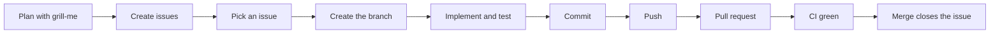

# Development workflow

How work goes from an idea to a change on `main`. Most steps are backed by something in the repository (issue and PR templates, git hooks, CI and the rules in [`AGENTS.md`](../AGENTS.md)).



## 1. Plan with `grill-me`

Before creating tasks, run the `/grill-me` skill and describe the feature, page or decision to plan. It interviews you in rounds, with a recommended answer for each question, and looks at the code instead of asking whenever the code can answer.

The session ends with a set of decisions. Turn them into tasks, each one small enough to fit in a single pull request.

## 2. Create the issues

Create each task from the **Task** template (`.github/ISSUE_TEMPLATE/task.md`), in the GitHub UI or with `gh issue create`. Issues are written in Portuguese, so the template's sections are too:

| Section  | What goes in it                                                                                                                                                      |
| -------- | -------------------------------------------------------------------------------------------------------------------------------------------------------------------- |
| Contexto | Why the task exists and the current state. Describe the problem, not the solution.                                                                                   |
| Tarefas  | A checklist with one verifiable deliverable per item. Use `code` for routes, files and components. Only ask for tests of our own logic (see Testing in `AGENTS.md`). |
| Notas    | Optional. Decisions already made, what is **not** part of the issue and which issues it depends on (`Depende de #<n>`). Remove it if empty.                          |

- The title is in Portuguese, a short summary in the imperative (e.g. `Selecionar a fonte do custo usada na margem do Dashboard`).
- Record the dependencies in Notas, so the order of the work is explicit.

## 3. Pick an issue

Take the next open issue whose dependencies (the `Depende de ...` lines in Notas) are already closed. Read the whole issue, Notas included, before starting.

When an AI agent picks the issue, it presents a summary of the plan (branch, steps, files and open decisions) and waits for explicit approval before changing anything (see Task Rules in [`AGENTS.md`](../AGENTS.md)).

## 4. Create the branch

Never work on `main`. The name follows `<scope>/<title>#<issue>`, with the title in English (see Branch Rules in [`AGENTS.md`](../AGENTS.md)). Quote it, because `#` is special in shells:

```bash
git switch main && git pull
git switch -c 'feat/orders-report#10'
```

## 5. Implement and test

- Use the Context7 MCP for the docs of any library, framework or CLI.
- A new entity (model + page + form)? Use the `new-entity` skill.
- A new shared component? Use the `new-component` skill.
- Designing or reshaping the interface? Use the `frontend-design` and `impeccable` skills.
- After changing anything in `src/components`, `src/pages` or `src/layout`, run the `ui-reviewer` subagent.
- To check the change in the browser, run `pnpm db:seed` and `pnpm dev` and follow [`docs/local-testing.md`](./local-testing.md), by hand or with the Playwright MCP.
- If the change alters what the user sees or does, update `docs/local-testing.md` in the same branch.
- Install dependencies with `pnpm add -E <pkg>` (or `pnpm add -D -E <pkg>`), to keep the versions pinned.
- Add or update the tests with the code: unit tests in `*.test.ts(x)` next to the code and e2e tests in `src/tests/e2e` (see Testing in [`AGENTS.md`](../AGENTS.md)).
- If the task changes a convention, update `AGENTS.md` in the same branch.

Check locally before committing:

```bash
pnpm type-check && pnpm eslint:check && pnpm prettier:check && pnpm spell:check && pnpm test
```

And, if the change touches UI flows, the e2e suite, which restarts the emulators:

```bash
pnpm test:e2e
```

Before opening the pull request, run the `review-copy` skill on the diff to review naming, comments, test descriptions, UI copy and docs.

## 6. Commit

Follow the Commit Rules in [`AGENTS.md`](../AGENTS.md): English, imperative, lowercase, a list as the body and an `Issue: #<number>` line. Type the plain prefix (`feat: ...`) and the `commit-msg` hook adds the emoji.

- An AI agent only commits after the user approves the message.
- Each commit is a single logical change.
- `pre-commit` runs `lint-staged` on the staged files: ESLint, Prettier, cspell and the related unit tests (`vitest related`).
- Stage only the files that belong to the change.

## 7. Push

```bash
git push -u origin 'feat/orders-report#10'
```

`pre-push` runs `pnpm type-check` and `pnpm test:e2e`, which restarts the emulators. The push is rejected if either fails.

## 8. Open the pull request

Open the PR against `main`, following the template (`.github/pull_request_template.md`):

```bash
gh pr create --base main --head 'feat/orders-report#10' \
  --title "✨ feat: add orders report" --body-file pr-body.md
```

- **Title:** follows the commit convention (emoji prefix, imperative, lowercase).
- **Description:** in English, with `Summary` (what changed and why; in a review with several findings, group them by severity/category), `Test plan` (what was checked) and `Closes #<issue>`, so the merge closes the issue.

The PR triggers the `.github/workflows/ci.yml` workflow (see CI in [`AGENTS.md`](../AGENTS.md)): `commitlint` on the PR's commits, types, lint, formatting, spelling, unit tests and e2e tests. Follow it with `gh pr checks --watch`. Netlify also builds a deploy preview of the PR.

## 9. Merge and close

1. Wait for the PR checks to pass: the `main` ruleset blocks the merge while any of them fails.
2. In the issue, tick each completed checklist item (`- [x]`). Don't close an issue with unchecked items, unless they were dropped or moved, and say so in a comment.
3. Merge with a **merge commit** (`gh pr merge --merge`), the only option enabled in the repository, which keeps each commit of the PR as `commitlint` validated it. The merge commit (`Merge pull request #...`) doesn't need to follow the Commit Rules.
4. GitHub deletes the remote branch after the merge, and Netlify deploys `main` to production. Update the local `main` and delete the local branch:

   ```bash
   git switch main && git pull
   git branch -d 'feat/orders-report#10'
   ```

5. Confirm that the issue was closed.
