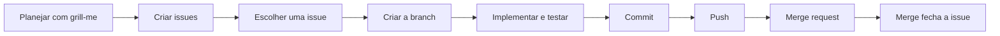

# Fluxo de trabalho

Como o trabalho vai de uma ideia a uma mudança na `main`. A maior parte dos passos é sustentada por algo no repositório (templates de issue e MR, git hooks e as regras do [`AGENTS.md`](../AGENTS.md)).



## 1. Planejar com `grill-me`

Antes de criar tarefas, rode a skill `/grill-me` e descreva a funcionalidade, a página ou a decisão a planejar. Ela entrevista você em rodadas, com uma resposta recomendada para cada pergunta, e consulta o código em vez de perguntar sempre que o código puder responder.

O resultado da sessão é um conjunto de decisões. Transforme-as em tarefas, cada uma pequena o bastante para caber em uma única merge request.

## 2. Criar as issues

Crie cada tarefa a partir do template **Task** (`.gitlab/issue_templates/task.md`), na UI do GitLab ou com `glab issue create`:

| Seção    | O que vai nela                                                                                                                                                         |
| -------- | ---------------------------------------------------------------------------------------------------------------------------------------------------------------------- |
| Contexto | Por que a tarefa existe e qual o estado atual. Descreva o problema, não a solução.                                                                                     |
| Tarefas  | Checklist com uma entrega verificável por item. Use `code` para rotas, arquivos e componentes. Peça apenas testes da nossa própria lógica (ver Testes no `AGENTS.md`). |
| Notas    | Opcional. Decisões já tomadas, o que **não** faz parte da issue e de quais issues ela depende (`Depende de #<n>`). Remova se estiver vazia.                            |

- Título em português, como um resumo curto no imperativo (ex: `Selecionar a fonte do custo usada na margem do Dashboard`).
- Registre as dependências em Notas, para que a ordem do trabalho fique explícita.

## 3. Escolher uma issue

Pegue a próxima issue aberta cujas dependências (as linhas `Depende de ...` em Notas) já estejam fechadas. Leia a issue inteira, incluindo as Notas, antes de começar.

Quando um agente de IA pega a issue, ele apresenta um resumo do plano (branch, passos, arquivos e decisões em aberto) e espera aprovação explícita antes de mudar qualquer coisa (ver Regras de tarefa no [`AGENTS.md`](../AGENTS.md)).

## 4. Criar a branch

Nunca trabalhe na `main`. O nome segue `<prefixo>/<titulo>#<issue>` (ver Regras de branch no [`AGENTS.md`](../AGENTS.md)). Use aspas, porque `#` é especial no shell:

```bash
git switch main && git pull
git switch -c 'feat/relatorio-pedidos#10'
```

## 5. Implementar e testar

- Use o MCP Context7 para a documentação de qualquer biblioteca, framework ou CLI.
- Nova entidade (model + página + formulário)? Use a skill `new-entity`.
- Novo componente compartilhado? Use a skill `new-component`.
- Desenhando ou reformulando interface? Use as skills `frontend-design` e `impeccable`.
- Depois de mudar algo em `src/components`, `src/pages` ou `src/layout`, rode o subagente `ui-reviewer`.
- Para conferir a mudança no browser, use o MCP Playwright com `pnpm dev`.
- Instale dependências com `pnpm add -E <pkg>` (ou `pnpm add -D -E <pkg>`), para manter as versões fixas.
- Adicione ou atualize os testes junto com o código: unitários em `src/tests/vitest` e e2e em `src/tests/playwright` (ver Testes no [`AGENTS.md`](../AGENTS.md)).
- Se a tarefa muda uma convenção, atualize o `AGENTS.md` na mesma branch.

Verifique localmente antes de commitar:

```bash
pnpm type-check && pnpm eslint:check && pnpm prettier:check && pnpm test
```

E, se a mudança toca fluxos de UI, a suíte e2e (com os emuladores rodando):

```bash
pnpm emulators:start > /tmp/emulators.log 2>&1 &
pnpm test:e2e
```

## 6. Commit

Siga as Regras de commit do [`AGENTS.md`](../AGENTS.md): inglês, imperativo, minúsculas, corpo em lista e linha `Issue: #<número>`. Digite o prefixo simples (`feat: ...`) e o hook `commit-msg` adiciona o emoji.

- Um agente de IA só commita depois que o usuário aprova a mensagem.
- Cada commit é uma única mudança lógica.
- `pre-commit` roda `lint-staged` (ESLint e Prettier) nos arquivos staged.
- Faça stage apenas dos arquivos que pertencem à mudança.

## 7. Push

```bash
git push -u origin 'feat/relatorio-pedidos#10'
```

`pre-push` roda `pnpm type-check` e `pnpm test:e2e`, então os emuladores precisam estar rodando (`pnpm emulators:start`). O push é rejeitado se algum falhar.

## 8. Abrir a merge request

Abra a MR contra a `main` com o template **Default** (`.gitlab/merge_request_templates/default.md`):

```bash
glab mr create --source-branch 'feat/relatorio-pedidos#10' --target-branch main \
  --title "✨ feat: add orders report" --description "$(cat descricao.md)"
```

- **Título:** segue a convenção de commits (prefixo com emoji, imperativo, minúsculo).
- **Descrição:** `Resumo` (o que mudou e por quê; num review com vários achados, agrupe por severidade/categoria), `Plano de testes` (o que foi verificado) e `Closes #<issue>`, para que o merge feche a issue.

## 9. Merge e fechamento

1. Na issue, marque cada item concluído do checklist (`- [x]`). Não feche uma issue com itens desmarcados, a menos que tenham sido descartados ou movidos, e diga isso em um comentário.
2. Faça o merge com **merge commit**, que mantém cada commit da MR como foi validado pelo `commitlint`. O commit de merge (`Merge branch '...' into 'main'`) não precisa seguir as Regras de commit.
3. Apague a branch e atualize a `main` local:

   ```bash
   git switch main && git pull
   git branch -d 'feat/relatorio-pedidos#10'
   ```

4. Confirme que a issue foi fechada.
